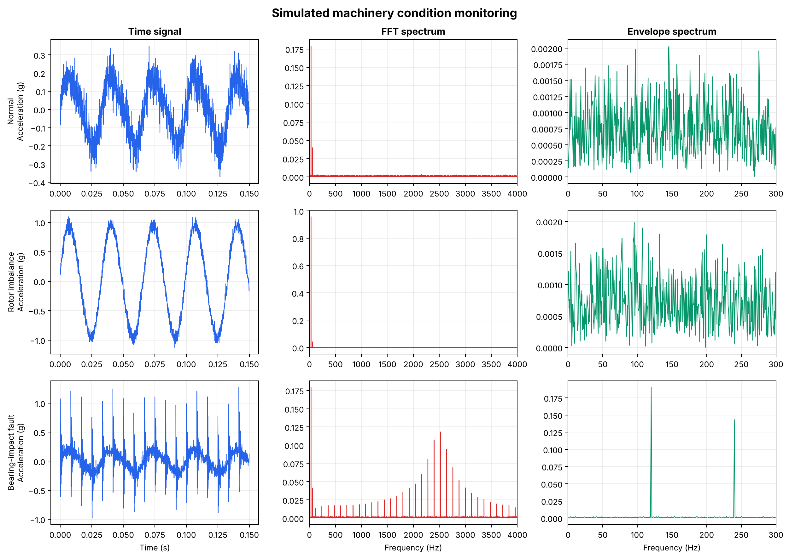

# Vibration-Based Machinery Fault Detection

A condition-monitoring project that detects common rotating-machinery faults from
accelerometer signals. It uses classic vibration-analysis techniques: **time-domain
statistics, FFT spectra and Hilbert envelope analysis**. These feed a transparent,
rule-based classifier that tells apart **normal operation, rotor imbalance and a
bearing-impact fault**.

The signals are physically motivated **simulations**. Because they are controlled, the
true fault characteristics are known exactly, so each step of the method can be checked
against the right answer.



## Key results

All three conditions are classified correctly. They are also classified correctly
across 20 extra random noise seeds, which are checked in the test suite.

| Condition | Predicted | RMS (g) | Peak (g) | Crest factor | Kurtosis | Dominant freq. (Hz) | Envelope peak (Hz) | Resonance energy |
|-----------|-----------|--------:|---------:|-------------:|---------:|--------------------:|-------------------:|-----------------:|
| Normal        | normal        | 0.143 | 0.415 | 2.90 | 2.08 | 30 | – | 0.0019 |
| Imbalance     | imbalance     | 0.680 | 1.138 | 1.67 | 1.53 | 30 | – | 0.0018 |
| Bearing fault | bearing_fault | 0.237 | 1.311 | 5.54 | 7.67 | 30 | **120** | **0.0495** |

*Envelope peaks for the normal and imbalance cases come from noise only and have no
diagnostic meaning, so they are shown as "–".*

What the analysis shows:

- **Rotor imbalance** raises the overall vibration level (RMS ×4.7), and nearly all the
  energy sits at the **30 Hz shaft frequency (1×)**. It stays a smooth sinusoid, so the
  crest factor and kurtosis actually *fall*. The fault changes how much the machine
  vibrates, not the shape of the vibration.
- **The bearing fault** hardly changes RMS (0.14 → 0.24 g), so an RMS alarm alone would
  likely miss it. Its signature lies elsewhere:
  - **Kurtosis rises from about 2 to 7.7** and the **crest factor from 2.9 to 5.5**. Both point to sharp,
    impulsive events (a pure sine wave has a kurtosis of 1.5; Gaussian noise has 3).
  - In the **FFT**, the impacts excite a **2.5 kHz structural resonance**, which shows up as a family
    of sidebands spaced 120 Hz apart. Energy in the resonance band rises about 26×.
  - **Envelope analysis** (band-pass around the resonance → Hilbert transform →
    spectrum of the envelope) recovers the **120 Hz impact repetition rate** and its
    2× harmonic. This is how the fault frequency is identified in practice.

## Method

```text
accelerometer signal (12 kHz)
  ├─► time-domain features:  RMS, peak, crest factor, kurtosis
  ├─► FFT (Hann window):     dominant frequency, energy in 1.5–3.5 kHz resonance band
  └─► envelope analysis:     4th-order Butterworth band-pass (1.5–3.5 kHz, zero-phase)
                             → |Hilbert transform| → FFT of envelope → peak in 20–500 Hz
          ▼
rule-based classifier
```

**Signal simulation** (2 s at 12 kHz, 30 Hz shaft speed):

| Case | Model |
|------|-------|
| Normal | 1× shaft sinusoid + small 2× harmonic + Gaussian sensor noise |
| Imbalance | Normal + a large extra 1× component (imbalance acts like a once-per-revolution rotating force) |
| Bearing fault | Normal + impacts repeating at 120 Hz, each exciting a decaying 2.5 kHz resonance (convolved impulse response) |

**Classification rules** are deliberately simple and readable:

```text
if resonance_energy > 0.01 or kurtosis > 4.5         → bearing_fault
elif RMS > 0.45 g and dominant frequency is 25–35 Hz → imbalance
else                                                 → normal
```

Interpretable rules were chosen over a machine-learning model on purpose. With only
simulated data, a black-box classifier would learn the simulator rather than the
physics. Each rule here maps directly to a physical fault mechanism.

## Tech stack

Python 3.10+ · NumPy · SciPy (signal filtering, Hilbert transform, statistics) · pandas · Matplotlib · pytest

## Getting started

```bash
python -m venv .venv
source .venv/bin/activate          # Windows: .venv\Scripts\activate
python -m pip install -r requirements.txt

python scripts/run_analysis.py     # simulate, analyse, classify, write outputs/
python -m pytest                   # run the test suite
```

The script writes the following to `outputs/`:

| File | Contents |
|------|----------|
| `fault_analysis.png` | 3 × 3 figure: time signal, FFT and envelope spectrum per condition |
| `diagnostic_features.csv` | All extracted features and the predicted condition |
| `analysis_summary.md` | Short auto-generated summary |
| `*_signal.csv` | Raw simulated signals (generated locally, not committed) |

## Project structure

```text
vibration-fault-detection/
├── src/vibration_analysis/
│   ├── __init__.py
│   └── signals.py           # signal simulation, feature extraction, envelope analysis, classifier
├── scripts/
│   └── run_analysis.py      # end-to-end pipeline and figure generation
├── tests/
│   └── test_signals.py
├── outputs/                 # generated figure, features table and summary
├── pyproject.toml
└── requirements.txt
```

## Testing

- Generated signals have the correct length for any sampling rate
- Imbalance produces much higher RMS than normal operation
- The envelope spectrum recovers the 120 Hz impact frequency to within 1 Hz
- The bearing fault raises resonance-band energy by more than 10×
- All three conditions are classified correctly for the default case **and for 20 independent noise seeds**
- Invalid conditions are rejected

## Limitations

- **Simulated data.** Real machines add multiple overlapping sources, varying speed and load,
  transmission-path effects and non-Gaussian noise.
- **Thresholds are tuned to this simulation.** They are not validated industrial alarm limits.
  In practice, limits come from baseline data for each machine and from standards such as ISO 10816 / 20816.
- **Known resonance band.** The envelope band-pass is set to the known resonance. On real data
  this band has to be found, for example with spectral kurtosis or a kurtogram.
- **Simplified bearing model.** Real bearing faults are modulated by load-zone and slip effects, and
  their frequencies depend on bearing geometry (BPFO, BPFI, BSF, FTF).

## Possible extensions

- Validate on a public labelled dataset (e.g. the CWRU bearing dataset)
- Automatic band selection with a kurtogram
- Compute bearing defect frequencies from geometry and match them to envelope peaks
- Add misalignment and looseness fault cases
- Compare the rule-based approach with a feature-based ML classifier on real data
